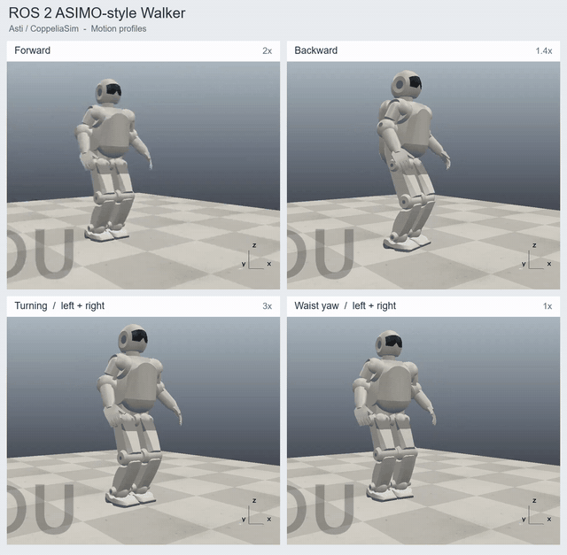
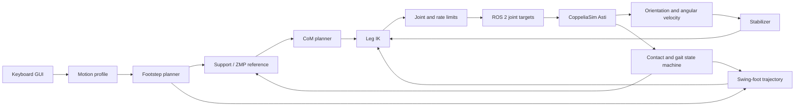

# ROS 2 ASIMO-style Walker

[](LICENSE)
[](https://docs.ros.org/en/humble/)
[](https://github.com/AstonDky/ros2-asimo-walker/actions/workflows/checks.yml)

[中文](README.zh-CN.md) · [Code walkthrough](tutorial/asimo_walker_code_reading_guide.md) · [Contributing](CONTRIBUTING.md)

A modular biped walking controller for the **Asti model in CoppeliaSim**, built with ROS 2 and Python. Keyboard requests select a motion profile; the controller plans footsteps, shifts the body toward a support reference, generates swing trajectories, solves leg inverse kinematics, and applies orientation feedback before publishing joint targets.

This is a simulation and learning project. “ASIMO-style” describes its inspiration; it is not Honda ASIMO software or an implementation of Honda’s controller.

## Demonstration

<a href="https://github.com/AstonDky/ros2-asimo-walker/releases/download/v0.1.0/asimo-montage.mp4"></a>

[Watch or download the 10-second MP4](https://github.com/AstonDky/ros2-asimo-walker/releases/download/v0.1.0/asimo-montage.mp4) · [Clip source and timings](docs/media/README.md)

The four panels show forward, backward, turning and standing waist-yaw motions from **different moments of one existing recording**, not synchronized experiments. Labels indicate playback speed, not measured walking performance. This preview is an edit of the existing simulation footage; no new simulation result is implied.

## Getting started

### 1. Prepare ROS 2 and CoppeliaSim

Use a Linux desktop with ROS 2, its system Python, `colcon`, `rosdep`, and Tk. The commands below use **Ubuntu 22.04 / ROS 2 Humble** as a setup example. This is not a claim that all simulator versions have been tested: the original recordings do not pin the CoppeliaSim version or physics settings.

Install ROS 2 using the [official Ubuntu instructions](https://docs.ros.org/en/humble/Installation/Ubuntu-Install-Debs.html). After configuring the ROS apt repository:

```bash
sudo apt update
sudo apt install git python3-colcon-common-extensions python3-rosdep python3-tk python3-numpy
source /opt/ros/humble/setup.bash
```

Install CoppeliaSim under its [applicable license](https://manual.coppeliarobotics.com/en/licensing.htm). Its `simROS2` plugin must load successfully and support `std_msgs/msg/Float64MultiArray`. Follow the [official ROS 2 tutorial](https://manual.coppeliarobotics.com/en/ros2Tutorial.htm); if you build the plugin, use the [simROS2 tag matching your simulator version](https://github.com/CoppeliaRobotics/simROS2). Source the ROS environment **before** launching CoppeliaSim.

### 2. Build this workspace

The repository root is already a colcon workspace; do not nest another copy in its own `src/`.

```bash
git clone https://github.com/AstonDky/ros2-asimo-walker.git
cd ros2-asimo-walker
# Run sudo rosdep init once if rosdep has never been initialized on this machine.
rosdep update
rosdep install --from-paths src --ignore-src -r -y --rosdistro humble
colcon build --symlink-install --packages-select robot_simulation_experiment
source install/setup.bash
ros2 pkg executables robot_simulation_experiment
```

The executable is `robot_simulation_experiment main.py`. It uses `/usr/bin/python3`, so install dependencies into the system environment used by ROS, rather than an unrelated virtual environment.

### 3. Open and start the scene

Open [`MAN.V1.2.ttt`](MAN.V1.2.ttt) in CoppeliaSim and start the simulation. This existing scene contains the Asti setup; its embedded model/assets are **not covered by this repository’s MIT grant**. See [third-party materials](THIRD_PARTY_NOTICES.md).

In a sourced terminal, verify feedback:

```bash
ros2 topic list
ros2 topic echo /robot/ori --once
ros2 topic echo /leftLegJoints --once
ros2 topic echo /rightLegJoints --once
```

The controller waits for orientation, angular velocity, position and both six-joint leg arrays. See the complete [topic contract](docs/ros-interface.md) if it remains in `WAIT`. A generic Asti model without matching ROS topic scripts does not satisfy that contract.

### 4. Run the controller

```bash
# Default: keyboard GUI; starts in idle hold.
ros2 run robot_simulation_experiment main.py

# Finite baseline walk: six steps, then standing recovery.
ros2 run robot_simulation_experiment main.py --ros-args -p mode:=walk

# Explicit GUI mode.
ros2 run robot_simulation_experiment main.py --ros-args -p mode:=teleop_gui
```

Run one controller at a time. The GUI needs an active graphical session. `auto_tune` is a private experimental extension, absent from this repository, and is not part of the public quick start.

## Keyboard controls

Focus the GUI window. Motion keys latch a request; pressing the same key again requests a stop. Direction changes wait for the controller’s step-completion/standing transition.

| Key | Request |
| --- | --- |
| `W` | Baseline forward walking, continuously extended |
| `Shift` | Faster forward profile, continuously extended |
| `S` | Conservative backward walking, continuously extended |
| `A` / `D` | Finite left/right turn profiles, 10 planned steps |
| `Q` / `E` | Standing pelvis-yaw target of +10° / −10°; press again to center |
| `Space` | Pause/resume request |
| `R` | Clear the keyboard request and return toward idle |
| `Esc` | Emergency command hold |

These are controller requests, not a simulator pause or a physical emergency-stop system. Reset/restart the simulation when the model has fallen.

## Control architecture



The state sequence is `WAIT → CROUCH → TRANSFER → SWING → TOUCHDOWN → DOUBLE_SUPPORT`, repeated for alternating legs, then `STAND → DONE`. Excessive relative pitch or roll triggers `ABORT`.

`ZMPPreviewPlanner` is a **bounded, damped CoM tracker**: it blends current and next support references, uses the LIPM-inspired scale `g / pelvis_height`, and limits velocity and acceleration. It is not classical optimal preview control and does not solve an MPC problem. CoP messages are stored but unused; there is no measured CoP/ZMP tracking loop. Without foot-force data, contact transitions use timing and attitude checks.

All controller modules live in [`scripts/asimo_walker/`](src/robot_simulation_experiment/scripts/asimo_walker):

| Module | Role |
| --- | --- |
| `main.py` | ROS node, feedback readiness, main loop and standing recovery |
| `teleop_command.py`, `teleop_profiles.py`, `teleop_gui.py` | Thread-safe keyboard requests, motion profiles and GUI |
| `footstep_planner.py` | Alternating target foot placements and small corrections |
| `zmp_reference.py`, `zmp_preview.py` | Support references and CoM trajectory |
| `swing_foot.py`, `leg_ik.py` | Swing trajectory and six-joint leg IK |
| `stabilizer.py` | Ankle/hip/arm feedback corrections and next-step adjustment |
| `contact_state_machine.py` | Support transitions, stop requests and tilt abort |

[Chinese technical notes](tutorial/locomotion_technical_notes_index.md) explain the full command-to-joint path.

## Parameters and limits

[`WalkerParams`](src/robot_simulation_experiment/scripts/asimo_walker/common.py) defines the baseline; [`teleop_profiles.py`](src/robot_simulation_experiment/scripts/asimo_walker/teleop_profiles.py) overrides it per GUI motion. **Only `mode` is exposed as a ROS parameter**; passing `-p step_length:=...` does not change the gait. Edit the corresponding data class/profile and rebuild when changing gait settings.

| Setting | Baseline |
| --- | ---: |
| Step length / width | 0.045 / 0.09 m |
| Swing / double-support time | 1.75 / 0.55 s |
| Foot clearance / pelvis height | 0.045 / 0.48 m |
| Nominal control period | 0.02 s (50 Hz) |
| Maximum joint rate | 1.45 rad/s |
| Maximum CoM speed / acceleration | 0.075 m/s / 0.20 m/s² |
| Relative pitch / roll abort threshold | 18° |

Existing profile values and development history are preserved in [the tuning record](docs/tuning-history.zh-CN.md). The loop uses fixed nominal `dt` and does not synchronize itself to a simulator stepping interface. IK lengths and joint conventions are model-specific; retargeting requires checking geometry, axis order and signs.

## Checks and troubleshooting

Offline checks require Python 3.10+ and no ROS installation:

```bash
python3 -B -m unittest discover -s tests -v
```

The offline job checks pure controller behavior, syntax and the entry-point import with small ROS API stubs. A separate job builds the package in the official ROS 2 Humble container and checks the installed imports and executable help. Neither job runs the scene or GUI, or establishes walking stability.

| Symptom | What to check |
| --- | --- |
| `No module named rclpy` | Source the ROS environment; use its matching system Python. |
| Package/executable not found | Build from the repository root and source `install/setup.bash`. |
| `waiting for feedback` | Start the scene, inspect plugin console errors, and verify [required topics](docs/ros-interface.md). Check matching `ROS_DOMAIN_ID` values. |
| Tk cannot open a display | Use a desktop session with Tk, or run `mode:=walk`. |
| `auto_tune` unavailable | Use `walk` or `teleop_gui`; the private extension is not distributed. |
| Immediate tilt abort or persistent drift | Reset the scene; verify joint order, signs, feedback units and physics timing before changing gains. |

## Original recordings and development notes

[Original teleoperation recording](https://github.com/user-attachments/assets/eb173fc7-6ced-482a-a4a4-7628c81fdf40) · [Walking recording — 18 May 2026](https://github.com/user-attachments/assets/54cd30d0-628e-40f6-b30a-78e2624fde47)

The [development record](docs/tuning-history.zh-CN.md) documents a six-step walk followed by standing recovery, and later manual tuning of forward, backward, turning and waist-yaw profiles. These are historical demonstrations; the repository does not contain a measured robustness benchmark or hardware validation result.

## Contributing, citation and license

See [CONTRIBUTING.md](CONTRIBUTING.md), [CHANGELOG.md](CHANGELOG.md) and [CITATION.cff](CITATION.cff). Cite the commit used; software citation metadata does not imply a paper publication.

Original controller code and project-authored documentation use the [MIT License](LICENSE). CoppeliaSim, its plugins, the Asti model and scene assets retain their own terms; see [THIRD_PARTY_NOTICES.md](THIRD_PARTY_NOTICES.md). The implementation was developed with substantial AI assistance; the author participated in architecture, core design choices and iterative simulation work.
