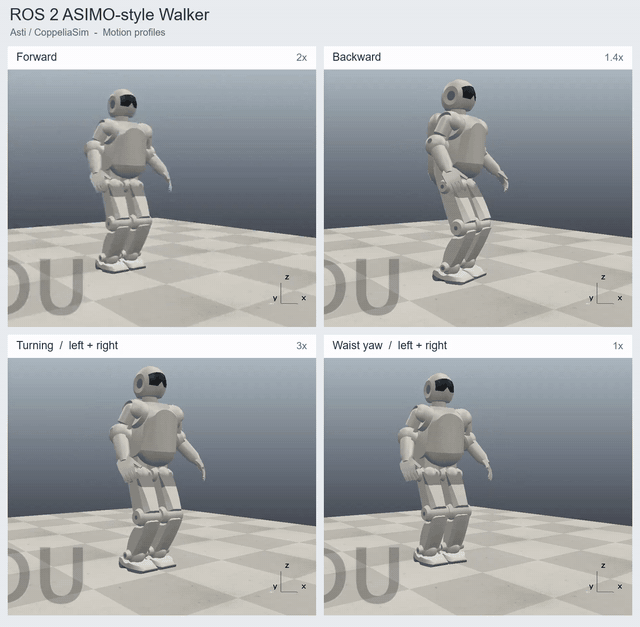
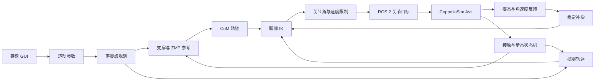

# ROS 2 ASIMO-style Walker

[](LICENSE)
[](https://docs.ros.org/en/humble/)
[](https://github.com/AstonDky/ros2-asimo-walker/actions/workflows/checks.yml)

[English](README.md) · [完整代码导读](tutorial/asimo_walker_code_reading_guide.md) · [参与贡献](CONTRIBUTING.md)

这是一个基于 **ROS 2、Python 和 CoppeliaSim Asti 模型**的双足行走控制项目。键盘指令选择运动参数，控制器依次完成落脚点规划、支撑重心转移、摆腿轨迹、腿部逆运动学和姿态反馈补偿，再向仿真机器人发布关节目标。

项目用于仿真实验与学习。“ASIMO-style”描述项目的设计参考，不代表本田 ASIMO 的软件或原厂控制器实现。

## 演示

<a href="https://github.com/AstonDky/ros2-asimo-walker/releases/download/v0.1.0/asimo-montage.mp4"></a>

[观看或下载 10 秒 MP4](https://github.com/AstonDky/ros2-asimo-walker/releases/download/v0.1.0/asimo-montage.mp4) · [片段来源与时间](docs/media/README.md)

四格分别展示前进、后退、转向和站立扭腰，取自**同一份既有录像的不同时段**，并非同步进行的实验。图中速度标签表示播放倍速，不是实测行走速度。预览仅对已有仿真录像作剪辑，没有增加新的仿真结果。

## 安装与运行

### 1. 准备 ROS 2 和 CoppeliaSim

需要 Linux 桌面环境、ROS 2 对应的系统 Python、`colcon`、`rosdep` 和 Tk。下列命令以 **Ubuntu 22.04 / ROS 2 Humble** 为配置示例；原录像未固定 CoppeliaSim 版本及物理引擎设置，因此这里不把这一组合称为已复现环境。

先按 [ROS 2 官方说明](https://docs.ros.org/en/humble/Installation/Ubuntu-Install-Debs.html)安装 ROS 2。配置好 ROS apt 软件源后：

```bash
sudo apt update
sudo apt install git python3-colcon-common-extensions python3-rosdep python3-tk python3-numpy
source /opt/ros/humble/setup.bash
```

按其[适用许可](https://manual.coppeliarobotics.com/en/licensing.htm)安装 CoppeliaSim。`simROS2` 插件必须能正常加载，并支持 `std_msgs/msg/Float64MultiArray`。配置方法见 [CoppeliaSim 官方 ROS 2 教程](https://manual.coppeliarobotics.com/en/ros2Tutorial.htm)；需要编译插件时，选择与模拟器版本对应的 [simROS2 标签](https://github.com/CoppeliaRobotics/simROS2)。启动 CoppeliaSim 前先加载 ROS 环境。

### 2. 构建工作空间

仓库根目录本身就是 colcon 工作空间，不要再把整个仓库套入它自己的 `src/`。

```bash
git clone https://github.com/AstonDky/ros2-asimo-walker.git
cd ros2-asimo-walker
# 若本机从未初始化 rosdep，先单独运行一次 sudo rosdep init。
rosdep update
rosdep install --from-paths src --ignore-src -r -y --rosdistro humble
colcon build --symlink-install --packages-select robot_simulation_experiment
source install/setup.bash
ros2 pkg executables robot_simulation_experiment
```

安装后的入口是 `robot_simulation_experiment main.py`，使用 `/usr/bin/python3`。ROS 依赖应安装在对应的系统环境中，不能假定另一个虚拟环境能够导入它们。

### 3. 启动场景并检查反馈

在 CoppeliaSim 中打开 [`MAN.V1.2.ttt`](MAN.V1.2.ttt)，启动仿真。这个既有场景包含 Asti 设置；其中的模型与素材**不属于本仓库 MIT 授权范围**，具体见[第三方材料说明](THIRD_PARTY_NOTICES.md)。

在已加载 ROS 环境的终端检查：

```bash
ros2 topic list
ros2 topic echo /robot/ori --once
ros2 topic echo /leftLegJoints --once
ros2 topic echo /rightLegJoints --once
```

控制器需要姿态、角速度、位置和左右各六个腿关节反馈。一直停在 `WAIT` 时，按[完整话题约定](docs/ros-interface.md)逐项检查。仅拖入一个没有配套 ROS 脚本的 Asti 模型，不能满足这些输入要求。

### 4. 运行控制器

```bash
# 默认键盘 GUI，起始为 idle 保持状态。
ros2 run robot_simulation_experiment main.py

# 自动完成六步 baseline 行走，再恢复站立。
ros2 run robot_simulation_experiment main.py --ros-args -p mode:=walk

# 显式指定 GUI。
ros2 run robot_simulation_experiment main.py --ros-args -p mode:=teleop_gui
```

一次只运行一个控制器。GUI 需要桌面显示环境。`auto_tune` 依赖未公开的实验扩展，不属于本仓库可直接运行的功能。

## 键盘操作

先让 GUI 窗口获得焦点。运动键按一下锁定请求，再按同一键请求停步；切换方向时，控制器先经过当前步完成或站立恢复过程。

| 按键 | 功能 |
| --- | --- |
| `W` | baseline 前进，持续追加脚步 |
| `Shift` | 较快前进，持续追加脚步 |
| `S` | 保守后退，持续追加脚步 |
| `A` / `D` | 有限步数左转 / 右转，计划 10 步 |
| `Q` / `E` | 站立时骨盆 yaw 目标 +10° / −10°，再按回中 |
| `Space` | 请求暂停 / 恢复 |
| `R` | 清空键盘请求，转向 idle |
| `Esc` | 紧急保持当前关节命令 |

这些都是控制器请求，不会暂停模拟器，也不是真机急停系统。模型摔倒后应重置或重新启动仿真。

## 控制流程



状态依次为 `WAIT → CROUCH → TRANSFER → SWING → TOUCHDOWN → DOUBLE_SUPPORT`，左右脚交替，结束后进入 `STAND → DONE`。相对初始姿态的 pitch 或 roll 超过阈值时进入 `ABORT`。

`ZMPPreviewPlanner` 实际是**带阻尼和限幅的 CoM 跟踪器**：混合当前与下一支撑参考，以 `g / pelvis_height` 设置受 LIPM 启发的响应强度，再限制速度和加速度。它没有实现经典最优预瞄控制或 MPC 求解。当前 CoP 消息仅被保存，没有用于实测 ZMP/CoP 闭环跟踪；缺少足底力反馈时，接触切换依据时间和姿态条件完成。

控制模块均位于 [`scripts/asimo_walker/`](src/robot_simulation_experiment/scripts/asimo_walker)：

| 文件 | 作用 |
| --- | --- |
| `main.py` | ROS 节点、反馈等待、主循环与站立恢复 |
| `teleop_command.py`、`teleop_profiles.py`、`teleop_gui.py` | 线程安全的按键传递、运动参数与 GUI |
| `footstep_planner.py` | 交替落脚点及小幅修正 |
| `zmp_reference.py`、`zmp_preview.py` | 支撑参考与 CoM 轨迹 |
| `swing_foot.py`、`leg_ik.py` | 摆腿与每腿六关节逆运动学 |
| `stabilizer.py` | 踝、髋、手臂反馈补偿和下一落脚点修正 |
| `contact_state_machine.py` | 支撑切换、停步请求和倾角中止 |

完整的“按键到关节输出”解释见[技术笔记索引](tutorial/locomotion_technical_notes_index.md)。

## 参数与适用范围

[`WalkerParams`](src/robot_simulation_experiment/scripts/asimo_walker/common.py)定义 baseline，[`teleop_profiles.py`](src/robot_simulation_experiment/scripts/asimo_walker/teleop_profiles.py)按运动覆盖参数。**当前只有 `mode` 是 ROS 参数**；传入 `-p step_length:=...` 不会改变步态。调整步态时修改对应数据类或 profile，并重新构建。

| 参数 | baseline |
| --- | ---: |
| 步长 / 步宽 | 0.045 / 0.09 m |
| 单次摆腿 / 双脚支撑时间 | 1.75 / 0.55 s |
| 抬脚高度 / 骨盆高度 | 0.045 / 0.48 m |
| 名义控制周期 | 0.02 s（50 Hz） |
| 最大关节速度 | 1.45 rad/s |
| 最大 CoM 速度 / 加速度 | 0.075 m/s / 0.20 m/s² |
| 相对 pitch / roll 中止阈值 | 18° |

各按键的完整参数和原开发历史保留在[调参记录](docs/tuning-history.zh-CN.md)。主循环使用固定名义 `dt`，没有接入模拟器逐步同步控制；IK 连杆长度、关节顺序和正负方向针对当前模型，移植前需要重新核对。

## 检查与常见问题

离线检查只需要 Python 3.10+，不依赖 ROS：

```bash
python3 -B -m unittest discover -s tests -v
```

离线任务检查纯控制模块行为、Python 语法和使用小型 ROS 接口替身的入口导入；另一个任务在官方 ROS 2 Humble 容器中实际构建包，并检查安装后的导入和入口帮助。两者均不运行场景或 GUI，也不据此证明行走稳定性。

| 现象 | 检查方法 |
| --- | --- |
| 无法导入 `rclpy` | 先加载 ROS 环境，使用该安装对应的系统 Python。 |
| 找不到包或入口 | 从仓库根目录构建，并在当前终端加载 `install/setup.bash`。 |
| 持续 `waiting for feedback` | 启动场景，检查插件日志和[必需话题](docs/ros-interface.md)，确认两端 `ROS_DOMAIN_ID` 一致。 |
| Tk 无法连接显示器 | 使用桌面会话并安装 Tk，或用 `mode:=walk`。 |
| `auto_tune` 不可用 | 使用公开的 `walk` / `teleop_gui`；仓库没有私有调参扩展。 |
| 立即倾角中止或持续漂移 | 重置场景，先核对关节顺序、方向、反馈单位与物理时序，再考虑改增益。 |

## 原始录像与开发记录

[原始遥操作录像](https://github.com/user-attachments/assets/eb173fc7-6ced-482a-a4a4-7628c81fdf40) · [2026 年 5 月 18 日行走录像](https://github.com/user-attachments/assets/54cd30d0-628e-40f6-b30a-78e2624fde47)

[原开发记录](docs/tuning-history.zh-CN.md)记载了六步行走后的站立恢复，以及后来对前进、后退、转向和扭腰参数的手动调试。这些资料是当时的演示与调参记录；仓库没有定量鲁棒性基准或真机验证结果。

## 贡献、引用与许可

贡献方式见 [CONTRIBUTING.md](CONTRIBUTING.md)，变更记录见 [CHANGELOG.md](CHANGELOG.md)，软件引用信息见 [CITATION.cff](CITATION.cff)。引用时记录具体 commit，不把软件引用写成论文发表。

项目自有控制器源码和自编文档采用 [MIT License](LICENSE)。CoppeliaSim、插件、Asti 模型和场景素材保留各自许可，详见 [THIRD_PARTY_NOTICES.md](THIRD_PARTY_NOTICES.md)。
